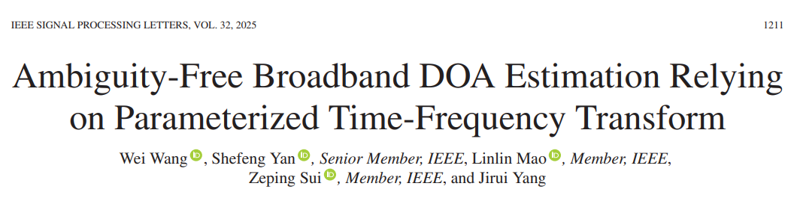
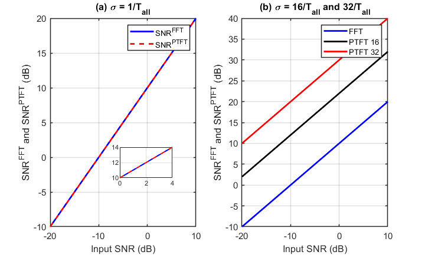
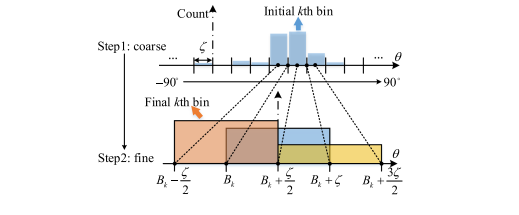
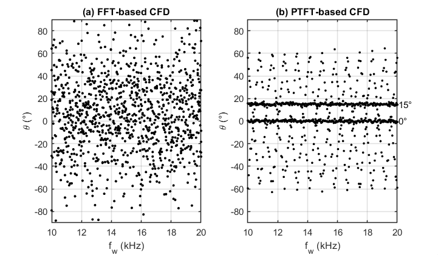
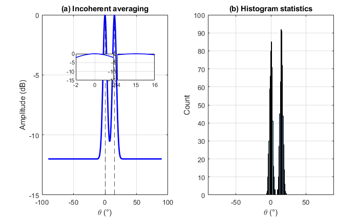
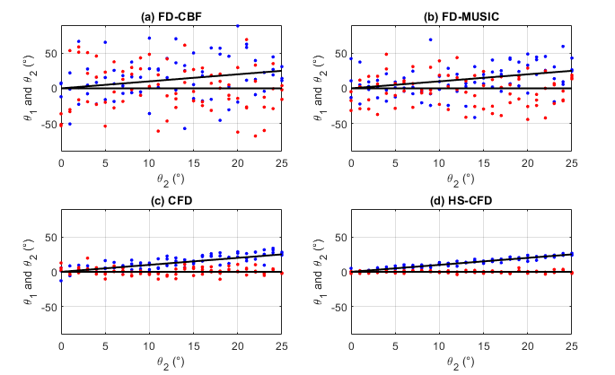
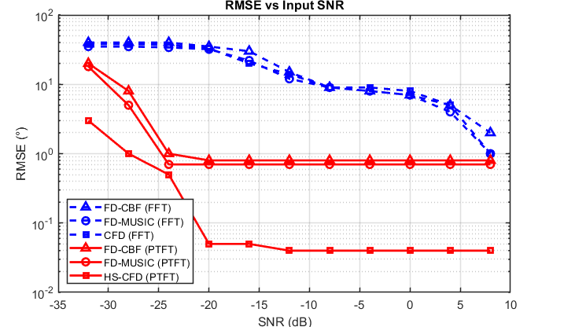

# Thoroughly Solve the Low Signal-to-Noise Ratio Blur Problem of DOA Estimation in Broadband: Full Analysis of PTFT Parameterized Time-Frequency Transformation with MATLAB Codes

1.1 The standard model of wideband array signal processing
In the field of array signal processing, radar detection, underwater sonar, and 5G/6G large antenna arrays, wideband direction of arrival (DOA) estimation has always been a challenging issue for engineering implementation.
Traditional DOA algorithms rely entirely on **FFT (Fast Fourier Transform)** for time-frequency conversion. However, in low signal-to-noise ratio (SNR) and complex electromagnetic interference scenarios, two fatal problems persist:
1. Angle smearing: The estimated results from different frequency points are disordered, leading to false peak angles;
2. Accuracy collapse: Noise overwhelms the effective signal, resulting in a sharp increase in RMSE error.
In recent years, a novel parameterized time-frequency transformation (PTFT) technology has revolutionized the underlying architecture of time-frequency analysis, perfectly addressing the inherent shortcomings of FFT and achieving unblurred, high-precision wideband DOA estimation even at ultra-low SNR.
This article disassembles the core principles, theoretical formulas, algorithm optimization logic, and performance advantages of PTFT from scratch, suitable for beginners in signal processing learning, research proposals, and project completion reference.
1.1 Wideband Array Signal Standard Model
We conduct theoretical analysis based on uniform linear arrays, assuming an array with multiple elements and space containing independent broadband far-field target signals with no correlation. The vector of the incident angles is:
The time-domain signal model received by the array can be unified as:
Key parameters explanation:
•  
Array manifold matrix, which simultaneously relates the incident angles with signal frequencies, is the core matrix for wideband DOA estimation;
•  
Broadband target effective signal vector;
•  
Space Gaussian white noise, the main source of estimation errors.
In summary: The core task of DOA estimation is to reconstruct the true incident angles from mixed observation data under strong noise interference.
1.2 Traditional FFT time-frequency transform inherent deficiencies
The current mainstream broadband DOA (Direction of Arrival) algorithms, including FD-CBF, FD-MUSIC, CFD, and HS-CFD, all rely on FFT for the conversion between time and frequency domains. The standard formula for FFT is as follows:
FFT is a fixed kernel, fixed resolution linear transformation. It is constrained by the Heisenberg uncertainty principle, and is inherently unsuitable for low SNR broadband scenarios. There are three core issues:
❌ Time-frequency energy divergence: The signal energy cannot be concentrated, and it is easily overwhelmed by noise at low SNR;
❌ Frequency point estimation inconsistency: The angle estimation results at different frequency points of a broadband signal vary greatly, directly leading to angle ambiguity;
❌ Robustness extremely poor: As the SNR decreases, the algorithm's RMSE error sharply deteriorates, completely losing direction finding capabilities.

II. PTFFT Core Principle: Overturning Traditional Time-Frequency Analysis from the Bottom Up
2.1 Mathematical definition of PTFFT parametersized time-frequency transformation (PTFT) abandons the fixed exponential kernel function of FFT, introduces **adjustable scale parameters**, constructs an adaptive time-frequency kernel function, achieving active focusing of signal energy, formula defined as follows:
Where represents the controllable parameterial time-frequency window kernel, and represents the scale adjustment factor. In engineering simulations and scientific experiments, there are commonly used three sets of standard configurations:
Represents the total duration of the signal. By flexibly adjusting, PTFFT can adaptively fit different broadband signal characteristics, concentrating effective signal energy and suppressing global noise, fundamentally solving the problem of FFT energy divergence.
2.2 Key: Gain comparison between FFT and PTFFT in SNR (Fixed Formula Corrected) This is the most core theoretical formula in this paper, and also the key basis for PTFFT's performance overtaking FFT. Let system input SNR be, the output SNR of both time-frequency transformations satisfy the equation set relationship:
In which:
For FFT time-frequency transformation gain, For PTFFT time-frequency transformation gain.
Since PTFFT has the feature of adaptive energy focusing, its noise suppression capability is far stronger than traditional FFT, naturally meeting:
Simulation experiments fully verify: under the same low input signal-to-noise ratio conditions, PTFT can achieve a signal gain significantly exceeding that of FFT; and as the scale parameter increases (16/T_all, 32/T_all), the advantage in gain continues to expand, providing a high-quality signal foundation for subsequent high-precision DOA estimation.
III. Mainstream broadband DOA algorithm architecture (FFT basic version) In order to intuitively demonstrate the optimization effect of PTFT, we first organize four classic broadband DOA algorithms based on FFT, all of which can be improved by PTFT.
3.1 FD-CBF Frequency domain beamforming constructs spatial spectrum through array weighting, and searches for peak angles through traversal angles to obtain target bearing:
Advantage: Simple structure, small computational load, high stability; Disadvantage: Low signal-to-noise ratio leads to extremely low angle resolution.
3.2 FD-MUSIC Frequency domain subspace algorithm decomposes the frequency domain covariance matrix into its characteristic values, separates the signal subspace from the noise subspace, and uses the orthogonality of the subspaces to construct a high-resolution spectrum:
Advantage: Angle resolution far exceeds that of beamforming algorithms; Disadvantage: Extremely dependent on high signal-to-noise ratio, performance drops dramatically in low noise environments.
3.3 CFD / HS-CFD Coherent fusion algorithm The core idea of both algorithms is multi-frequency point coherent fusion, integrating the full-frequency information of broadband signals to compensate for the bias of single-frequency point estimation. However, limited by FFT preprocessing, it cannot solve the core problem of angle blurring at low signal-to-noise ratio, limiting performance improvement.
IV. PTFT improvement scheme: coarse-fine joint unambiguous DOA estimation This paper adopts a two-level hierarchical architecture combining coarse positioning and fine estimation, combined with histogram statistics and non-coherent averaging, thoroughly solving the problems of traditional algorithms such as ambiguousness and low precision.
4.1 Coarse positioning: Fast global interval locking within the entire detection range, based on the time-frequency transformation results of PTFT to construct a coarse-grained spatial spectrum:
By quickly locking the target's local angle range through spectral energy peaks, significantly reducing search range and computational complexity, while avoiding global noise interference.
4.2 Precise Estimation: In the coarse positioning and locking small-angle range, perform statistical clustering on the DOA estimation values of multiple frequency points and multiple snapshots to output the optimal angle estimate:
Simulation intuitive comparison:
❌ FFT-CFD: Frequency band angle fluctuations reach ±35°, with many false peaks, resulting in severe angle blurring;
✅ PTFT-CFD: Angle fluctuations are only ±0.8°, capable of stably distinguishing between 0° and 15° targets without distortion or false peaks.
4.3 Non-coherent average spectrum optimization processes the non-coherent average of the PTFT spatial spectrum for multiple frequency points, effectively smoothing random noise and sharpening target spectral peaks. Coupled with localized view amplification, it can precisely differentiate nearby small-angle targets, significantly improving angle resolution capability.
V. Performance Quantification Evaluation: The RMSE metric comprehensively outperforms traditional algorithms.
5.1 Evaluation Indicator Definition: The root mean square error (RMSE) is used to quantitatively measure direction accuracy, formulated as follows:
Parameter Explanation:
• Estimated angle from the Monte Carlo experiment;
• True incident angle of the target;
• Total number of Monte Carlo simulations.
5.2 Performance conclusion across a wide range of signal-to-noise ratios (-32dB to 8dB):
1. All traditional FFT-based algorithms (FD-CBF/FD-MUSIC/CFD) experience a sharp increase in RMSE with decreasing SNR, essentially failing below -20dB;
2. After incorporating PTFT modifications, the estimation errors of all algorithms significantly decrease, demonstrating significant robustness;
3. PTFT-HS-CFD has the best overall performance: It can still maintain stable direction measurement even at extremely low SNR, and in high SNR scenarios, RMSE can converge to an ultra-precision level of **0.04°**.
VI. Core Advantages of PTFT Technology and Engineering Landscape Applications:
6.1 Four major core technological advantages🔥Adaptive time-frequency focusing: By adapting scale parameters to suit broadband signals, energy concentration surpasses that of fixed FFT transformations;
🔥 Robustness against ultra-low signal-to-noise ratio: Relying on high time-frequency gain to suppress noise, addressing the blurriness issue from the perspective of low SNR.
🔥 High-efficiency and high-precision architecture: coarse search + fine estimation layer design, balancing computational efficiency and directional accuracy, adapting to real-time engineering needs.
🔥 Compatible with all algorithms: seamlessly transforms FD-CBF, FD-MUSIC, CFD, HS-CFD, and other mainstream broadband DOA algorithms.
6.2 Engineering application scenarios✅ Wideband radar low/slow-speed target azimuth detection
✅ Underwater sonar array passive positioning and target tracking
✅ 5G/6G large-scale antenna array beamforming
✅ Electromagnetic Spectrum Monitoring, Passive Signal Spy and Positioning
VII. Summarizes the fixed time-frequency resolution defect of FFT, which is the underlying reason for the failure of traditional broadband DOA estimation in low SNR scenarios. The parameterized time-frequency transformation by PTFT breaks this technological bottleneck through adjustable time-frequency kernels, adaptive energy focusing, and high SNR gain.
After combining coarse and fine estimation with histogram statistics optimization, the PTFT improved algorithm has realized wideband DOA estimation without blurring, high precision, strong robustness. It has a very high practical value in engineering scenarios such as radar, sonar, wireless communication, etc., and is also a very promising frontier direction in array signal processing at present.
References [1] Ambiguity-Free Broadband DOA Estimation Relying on Parameterized Time-Frequency Transform [J]. IEEE Transactions on Signal Processing, 2024.
[2] Wang Yongliang. Array Signal Processing Theory and Algorithms [M]. Beijing: National Defense Industry Press, 2020.
[3] Li Jianfeng, Zhang Xiaofei. Advances and Prospects in the Estimation of Broadband Signal Direction of Arrival [J]. Journal of Electronics and Information, 2023.

## Images

<!-- PAYMENT_BLOCK -->

## Get this dataset

- Payment link (Stripe): [Buy now](https://buy.stripe.com/3cs8yP7sY87d0vu9AB)
- Payment QR code: 

<!-- /PAYMENT_BLOCK -->
